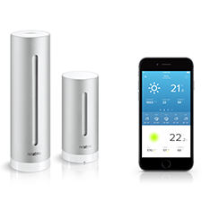

# ioBroker.netatmo

[](https://www.npmjs.com/package/iobroker.netatmo)
[](https://www.npmjs.com/package/iobroker.netatmo)


[](https://weblate.iobroker.net/engage/adapters/?utm_source=widget)

[](https://nodei.co/npm/iobroker.netatmo/)

**Tests:** 

**This adapter uses Sentry libraries to automatically report exceptions and code errors to the developers.** For more details and for information how to disable the error reporting see [Sentry-Plugin Documentation](https://github.com/ioBroker/plugin-sentry#plugin-sentry)!

## What does this adapter do?

The adapter brings your Netatmo devices into ioBroker. You see their values (e.g. temperature, rain, doorbell ring) as states and can use them in scripts and visualizations. Some devices can also be controlled (e.g. camera on/off, roller shutters).

| Product | What you get | Own Netatmo app needed? |
|---|---|---|
| Weather station with its modules (outdoor, rain, wind, indoor) | measurements, min/max, trends, battery | no |
| Healthy Home Coach | air quality, CO2, humidity, noise | no |
| Cameras (Welcome, Presence) and door/window sensors | status, events, persons, camera on/off | recommended |
| iDiamant / Bubendorff roller shutters | position, open/close/stop | no |
| Smart Video Doorbell | ring, calls, events | yes |
| Smart Smoke Alarm, Smart Carbon Monoxide Alarm | status, alarms | yes |

Thermostats and valves (Netatmo Energy) are not part of this adapter.

## What you need

* A Netatmo account with your devices.
* Recommended: an **own Netatmo app** (free, takes about 2 minutes, see step 2 below). Without it, all ioBroker users share one common app and its request limit. Netatmo plans to reduce these limits from March 2027, so an own app is the safe choice.
* Only for instant messages from cameras, doorbell, smoke and CO alarm: the ioBroker [iot adapter](https://github.com/ioBroker/ioBroker.iot) with an ioBroker Pro account (Assistant or Remote license). Without it, these devices are still updated, just every few minutes instead of immediately.

## Setup in 3 steps

Open the settings of the adapter instance.

1. **Choose your products** in the tab "Devices & login".
2. **Own Netatmo app** (recommended):
   * Click "Create Netatmo app" and log in with your Netatmo account.
   * Fill in the form (e.g. name "ioBroker" and a short description) and save.
   * Copy the "client ID" and "client secret" of the new app into the two fields of the adapter settings.
3. **Log in**: click "Log in with Netatmo", log in and allow access. The adapter saves the login and restarts. If no window opens, allow popups for the ioBroker admin page.

Repeat step 3 whenever you change the products or the app data, otherwise some data may be missing.

If you use cameras, doorbell or alarms and have the iot adapter: select your iot instance in the tab "Realtime events".

In the tab "Advanced" you can change how often the data is updated (default: every 10 minutes; Netatmo itself updates weather data only about every 10 minutes) and enter the elevation of your home for the dew point calculation.

## Using the data

You find all data in the objects tab under `netatmo.0`, sorted by home and device.

* `netatmo.0.info.connection` shows whether the connection to Netatmo works.
* Each device shows whether it is online: `info.reachable` (weather station and its modules: `Reachable`) is `false` when the device cannot be reached, e.g. without WiFi. Next to it you find signal strength, battery and firmware, as far as Netatmo provides them. A device going offline or coming back is also written to the log.
* **Doorbell:** `ring` becomes `true` when somebody rings and goes back to `false` after 60 seconds. `incoming_call`, `missed_call` and `accepted_call` show time and snapshot picture of the last call. Netatmo sends these messages with a delay of a few seconds up to about 2 minutes, and it does not always report an answered call.
* **Roller shutters:** set `targetPosition` (0–100 %, `-1` = stop, `-2` = jalousie mode for shutters with tiltable slats) or use the buttons `open`, `close` and `stop`. Netatmo does not report position changes made with the remote or the Netatmo app immediately; they show up with the next update.

### Mark persons as away or home (cameras)

For example for an alarm system, in a script:

```javascript
// all persons of all homes away
sendTo('netatmo.0', 'setAway');
// all persons of one home away
sendTo('netatmo.0', 'setAway', { homeId: '1234567890abcdefg' });
// only certain persons away
sendTo('netatmo.0', 'setAway', { homeId: '1234567890abcdefg', personsId: ['123123123123123'] });
// same parameters to mark persons as home
sendTo('netatmo.0', 'setHome', { homeId: '1234567890abcdefg' });
```

The `homeId` is the name of the top folder of your home in the objects tab, the person IDs are in the folder of the known persons.

## Changelog
<!--
    Placeholder for the next version (at the beginning of the line):
    ### **WORK IN PROGRESS**
-->
### **WORK IN PROGRESS**
* (@Schimi1983) README and configuration page simplified for easier setup (step-by-step guide, plain language)
* (@Schimi1983) Removed outdated admin/words.js and the deprecated common.title

### 3.2.0 (2026-11-04)
* (@Schimi1983) Fixed adapter crash when changing a state (e.g. camera monitoring) while the access token had expired
* (@Schimi1983) Token refresh: an invalid refresh token is now reported (re-authentication required) instead of silently starting without data; no endless refresh loop; only one refresh at a time (Netatmo rotates refresh tokens)
* (@Schimi1983) Access and refresh tokens and the client secret are no longer written to the log
* (@Schimi1983) Update intervals are validated also with own client ID (empty value led to polling every millisecond)
* (@Schimi1983) A failing event request no longer discards the home and device status of the update cycle
* (@Schimi1983) Device status for all devices: reachable, error, signal strength, battery and firmware; offline/online is logged; new state info.connection
* (@Schimi1983) Temporary Netatmo outages (5xx, timeouts, "Service temporarily unavailable") are logged as warning and only as error after 3 failed requests in a row; recovery is logged; no more duplicate log entries per error
* (@Schimi1983) Realtime events keep working after re-authentication
* (@Schimi1983) Doorbell: "ring" is reset automatically 60 seconds after the call (Netatmo does not reliably send accepted_call), immediately on accepted_call/missed_call, and on adapter start
* (@Schimi1983) README reworked according to the ioBroker guidelines, older changelog entries moved to CHANGELOG_OLD.md
* (@Schimi1983) Reworked configuration page: tabs, responsive layout, info boxes, units and input validation, translations for all languages; requires admin >= 7.6.19
* (@Schimi1983) Help text for event retention corrected (hours instead of minutes); default update interval 10 minutes
* (@Schimi1983) State roles corrected according to the ioBroker state roles (e.g. `date` instead of the non-existing `value.date`, `text` for texts instead of the generic `state`, `level`/`value.blind` for roller shutters); only roles changed, IDs, types and values stay the same
* (@Apollon77) Removed the usage of a deprecated API from Netatmo which was used to enrich person data
* (@Apollon77) Added product type NACamDoorTag
* (@Apollon77) Allows value -2 for target position of Bubendorff roller shutters to put a Bubendorff shutter with jalousieable slats in jalousie mode

### 3.1.0 (2023-01-06)
* (Apollon77) Add support for Bubendorff roller shutters
* (Apollon77) Fix Monitoring State for Welcomes
* (Apollon77) Allow to just use CO2/Smoke sensors
* (Apollon77) Optimize Shutdown procedure

### 3.0.0 (2022-12-14)
* (Apollon77/bluefox) BREAKING CHANGE: Restructure Realtime events to be received via iot instance (iot >= 1.14.0 required)

### 2.1.2 (2022-11-17)
* (bluefox) Added missing objects for `Welcome` devices

### 2.1.1 (2022-09-30)
* (Apollon77) Make sure device types that require custom credentials are not selectable in UI without entering them
* (Apollon77) Fix a potential crash case

## License

The MIT License (MIT)

Copyright (c) 2016-2026 Patrick Arns <iobroker@patrick-arns.de>

Permission is hereby granted, free of charge, to any person obtaining a copy
of this software and associated documentation files (the "Software"), to deal
in the Software without restriction, including without limitation the rights
to use, copy, modify, merge, publish, distribute, sublicense, and/or sell
copies of the Software, and to permit persons to whom the Software is
furnished to do so, subject to the following conditions:

The above copyright notice and this permission notice shall be included in
all copies or substantial portions of the Software.

THE SOFTWARE IS PROVIDED "AS IS", WITHOUT WARRANTY OF ANY KIND, EXPRESS OR
IMPLIED, INCLUDING BUT NOT LIMITED TO THE WARRANTIES OF MERCHANTABILITY,
FITNESS FOR A PARTICULAR PURPOSE AND NONINFRINGEMENT. IN NO EVENT SHALL THE
AUTHORS OR COPYRIGHT HOLDERS BE LIABLE FOR ANY CLAIM, DAMAGES OR OTHER
LIABILITY, WHETHER IN AN ACTION OF CONTRACT, TORT OR OTHERWISE, ARISING FROM,
OUT OF OR IN CONNECTION WITH THE SOFTWARE OR THE USE OR OTHER DEALINGS IN
THE SOFTWARE.
